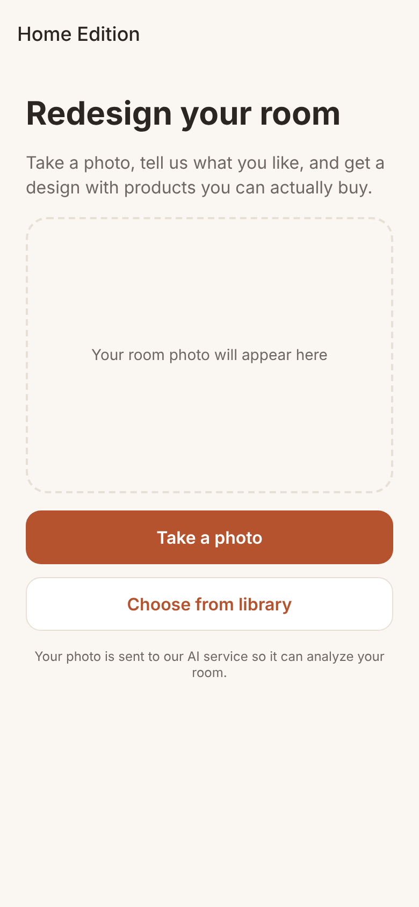
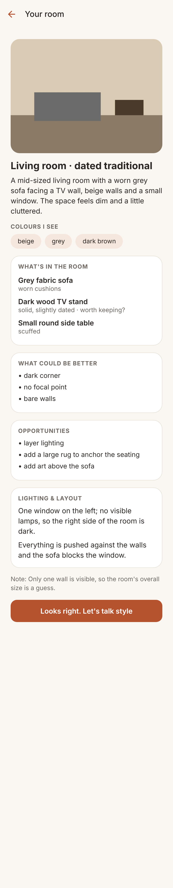
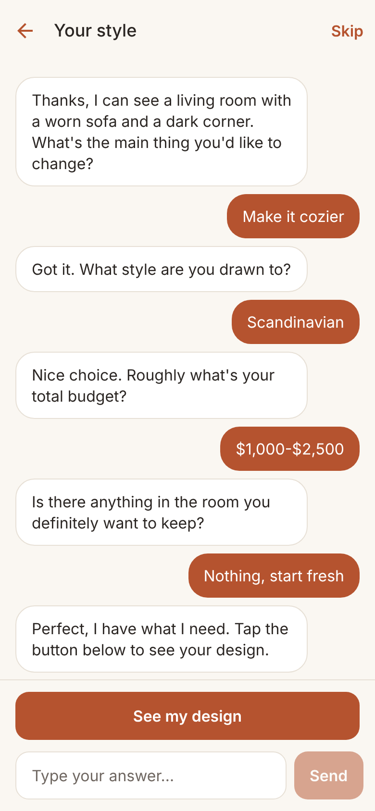
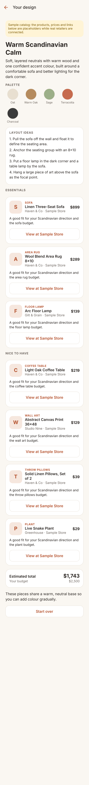

# Home Edition Kit

A mobile app that redesigns your room. Take a photo, answer a few questions, and get a design
brief (concept, colour palette, layout ideas) with specific products you can buy.

## What it looks like

Demo mode (the photo is a placeholder and the text is canned): photo, room analysis, interview,
design brief.

<p>
  
  
  
  
</p>

## Status

This is the first vertical slice: **photo → room analysis → intake interview → design brief with
product picks.**

| Piece | State |
|---|---|
| Photo capture / library pick, resize + re-encode on device | Working |
| Room analysis (Claude vision) | Built; **not yet run against the live API** (see "Not yet verified") |
| Adaptive intake chat that builds a user profile | Built; not yet run against the live API |
| Design plan + product picks from a catalog | Built; not yet run against the live API |
| Product catalog | **Sample data only.** Invented products, every link is `example.com` |
| Rendered "after" image of the redesigned room | Not started |
| Accounts, saved projects, persistence | Not started |

## How it fits together

```
apps/mobile   Expo (React Native) app: iOS, Android, and web from one codebase
apps/server   Node/Express API: holds the Anthropic key, calls Claude, searches the catalog
packages/shared   zod schemas + TypeScript types shared by both
```

The mobile app never talks to Anthropic. It calls the server, which keeps the API key private.

```
POST /api/room/analyze   photo        -> room analysis (Claude vision)
POST /api/intake         conversation -> next question, quick replies, updated profile
POST /api/brief          profile      -> plan (Claude) -> catalog search -> picks (Claude) -> brief
```

Design decisions worth knowing:

- **Claude never supplies product ids, links or totals.** It drafts a plan with "slots" (sofa, rug,
  lamp...). The server searches the catalog for each slot, Claude picks from those real candidates,
  and the server validates every id and computes the total itself. An id that wasn't offered for
  that slot is dropped (covered by tests).
- **Structured outputs.** Every model call returns JSON validated against a zod schema
  (`packages/shared/src/schemas.ts`), so the app gets typed data, not prose to parse.
- **Server is stateless.** The app sends the conversation and profile each turn. Nothing is stored yet.
- **Model is one setting.** `CLAUDE_MODEL` (default `claude-opus-5-5`). Reasoning effort is set per
  step in `apps/server/src/ai/claude.ts`: lower for chat turns, medium for analysis and planning.
- **Refusal fallbacks are on** (`fallbacks: "default"`), so a false-positive safety decline is retried
  on another model server-side instead of failing the user.
- **Cost guard-rails:** per-IP rate limit on `/api`, 5 MB image cap, 8 MB body cap, and token usage
  logged per call (never photos or chat text).

## Run it

You need [Node.js](https://nodejs.org) 22.9 or newer (the "LTS" download is fine). Open a terminal
in this folder and run:

```bash
npm install
```

You'll then use **two terminal windows**: one for the server, one for the app.

**Window 1: the server.** Start in demo mode, which returns canned answers, needs no API key and
costs nothing:

1. Create the settings file `apps/server/.env` containing the single line `AI_PROVIDER=mock`.
   The easiest way is one command, run from this folder:

   - **Windows (PowerShell):** `"AI_PROVIDER=mock" | Out-File -Encoding ascii apps\server\.env`
   - **Mac / Linux:** `echo AI_PROVIDER=mock > apps/server/.env`

   (Every other setting has a sensible default. `apps/server/.env.example` lists them all.)
2. Run:

```bash
npm run server
```

**Window 2: the app.**

```bash
npm run mobile
```

When it says it's ready, press **`w`** to open the app in your browser. A computer has no rear
camera, so use **Choose from library** and pick any photo. To use your phone instead, install
**Expo Go** from the App Store / Google Play and scan the QR code shown in the terminal (phone and
computer on the same Wi-Fi). The app finds the server automatically. Overrides and the
Android-emulator address are in `apps/mobile/.env.example`.

Demo mode gives the same pre-written room analysis and questions whatever photo you choose. To use
the real AI, put your key in `apps/server/.env` (`ANTHROPIC_API_KEY=...`), set
`AI_PROVIDER=claude`, and restart the server.

**Checks:**

```bash
npm test               # server tests (50)
npm run typecheck      # all workspaces
npm run build:server   # production bundle -> apps/server/dist
```

## Swapping in real products

Implement `CatalogProvider` (`apps/server/src/catalog/types.ts`): `search()` and
`categoryCounts()`, plus `affiliateDisclosure` if links earn commission. Then pass it to
`createApp` in `apps/server/src/index.ts` instead of `SampleCatalog`. The brief screen already
shows the disclosure text and a "sample catalog" banner automatically.

## Not yet verified

- **Live Claude calls.** There was no API key in the environment this was built in. Request
  shapes are checked against the SDK's types and a fake client, and the structured-output schemas
  were inspected, but no real request has been made. The first thing to do is run the app with a
  key and a real room photo.
- **Real devices.** The app was type-checked, bundled for Android with Metro, and driven end to
  end in a browser. It has not been run in Expo Go or a simulator. Camera permission flows in
  particular are untested.
- **Photo metadata.** The app re-encodes photos before upload, which should drop embedded
  metadata such as GPS location. Confirm on a real device before telling users that.

## Before real users

- Sign-in and per-user quotas. The rate limit is per IP only, and anything inside a mobile app
  can be extracted, so the server needs to know who is calling.
- HTTPS for the server (iOS blocks plain HTTP outside development).
- A privacy policy covering room photos and chat, and a decision on retention. Check Anthropic's
  current data-retention terms for the model you choose.
- Real affiliate/retailer data and the disclosures that come with it.

## Known dependency advisories

`npm audit` still reports advisories in Expo's build tooling (waiting on an Expo patch) and in
`zod` (no newer release exists yet). The server caps request sizes (8 MB body, at most 60 chat
messages) to limit exposure.

## Next steps

1. Run against the live API with a real photo and tune the prompts.
2. Render the redesigned room image (needs a separate image-editing model; Claude doesn't make images).
3. Persist projects and profiles; add accounts.
4. Connect a real product source.
